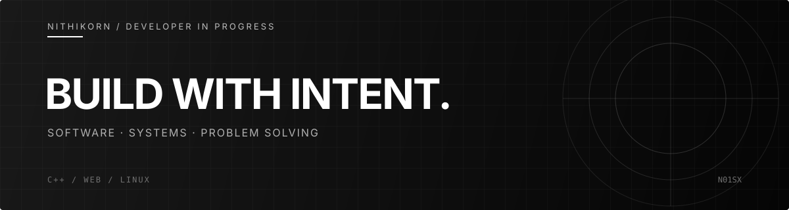

 

[GitHub](https://github.com/sing-real) &nbsp;·&nbsp; [Repositories](https://github.com/sing-real?tab=repositories)

---

## About

I'm **Nithikorn**, a student developer interested in software engineering, computer sci, and learning.
**Currently focused on:** Competitive Programming and Self-productive

## Tech Stack

**LANGUAGES**

**FRAMEWORKS & BACKEND**

**TOOLS & ENVIRONMENT**

## GitHub Activity

---

Learning continuously. Building thoughtfully.

